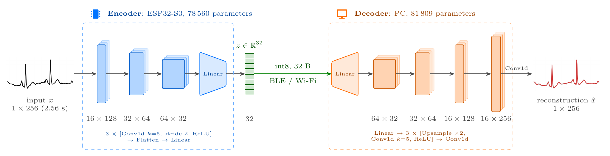

# ECG representation and reconstruction with a 1D convolutional autoencoder

Course project, Information Technologies in Medicine. Specification:
[ecg_course_project_specification.md](ecg_course_project_specification.md).

Compresses single-lead ECG (PTB-XL, lead II, 100 Hz) with a compact 1D convolutional autoencoder:
each 2.56 s window (256 samples) is encoded into a 32-dim latent vector, sent as 32 bytes of int8,
and reconstructed on the receiver. The encoder is small enough (78.6k parameters) to run on an ESP32-S3
next to an ADS1292R ECG front end; the decoder runs on a PC.



## Results (PTB-XL test fold 10, non-overlapping windows)

| Latent z | Ratio (int8) | PRDN median (IQR) | PRDN, int8 latent | PCA, same k |
|---|---|---|---|---|
| 8 | 64:1 | 45.4% (34.4–62.5) | 46.6% | 93.3% |
| 16 | 32:1 | 28.9% (21.6–39.7) | 29.3% | 85.7% |
| 32 | 16:1 | 17.9% (13.4–25.2) | 18.2% | 72.5% |
| 32, causal filter (deployable) | 16:1 | 18.3% (13.7–25.7) | 18.7% | 72.7% |

Width 16 for all rows. A research demonstrator, not a diagnostic device. The full report (Bulgarian)
is in `report/`.

## Setup

Requires [pixi](https://pixi.sh). The environment uses CUDA PyTorch (conda-forge).

```bash
pixi install
pixi run test          # unit tests
pixi run download      # PTB-XL records100 + metadata -> data/ptbxl
pixi run smoke         # small subset, 5 epochs, end-to-end check
```

## Experiments

```bash
pixi run train                                   # configs/default.yaml (z=16, width 8, HP 0.5 Hz zero-phase)
pixi run train --set "model.channels=[16,32,64]" # wider model (run name z16_w16_...)
pixi run train --set model.latent_dim=8          # any key can be overridden
pixi run train --set filter.highpass_hz=0.05     # cutoff comparison (separate data cache)
pixi run train --set filter.mode=causal          # streaming-style filter, as on the device
pixi run evaluate --all                          # metrics + figures for every run
pixi run compare                                 # runs/summary.csv
pixi run sweep                                   # z = 8, 16, 32, then evaluate + compare
pixi run filters                                 # filter response + example figures -> figures/
pixi run sweep-plot                              # latent sweep figure + table
pixi run report-figs                             # all report figures (Bulgarian labels)
pixi run report                                  # build report/main.pdf
```

Each run writes to `runs/<run_name>/`: `model.pt`, `config.yaml`, `history.csv`,
`metrics.json`, `per_window.csv`, `figures/`.

## Design decisions

| Decision | Choice | Reason |
|---|---|---|
| Split | official `strat_fold` 1-8 / 9 / 10 | patient-wise; split before windowing |
| Sampling rate | 100 Hz | the ADS1292R has no 100 SPS mode; the device will sample at 500 SPS and decimate by 5, which is how PTB-XL's 100 Hz files were made |
| Filtering | Butterworth high-pass in SOS form, whole 10 s record | `sosfiltfilt` padded with almost the whole record; causal mode starts from steady state (`sosfilt_zi`) |
| Scaling | one global scale (train std, in mV) | nothing per window has to be transmitted next to the latent vector |
| Windows | 256 samples; stride 128 for training, 256 for evaluation | overlap is augmentation only; the device sends non-overlapping windows, which keeps the 32:1 ratio |
| Model | Conv1d ×3 (stride 2, padding 2) → Linear → z; Linear → (Upsample + Conv1d) ×3 → Conv1d | encoder uses only operators likely supported by ESP-DL; no activation on z or output |
| Baseline | PCA with k = latent size | shows whether the CAE beats a linear method at equal payload |
| Reporting | median / IQR / mean PRDN per window and per recording | windows from one recording are correlated |

PRD and PRDN are ratios, so the global scale cancels. After high-pass filtering windows are
near zero-mean and PRD ≈ PRDN; published PRD values computed with a DC/ADC offset are not comparable.

The payload ratio (512 B raw 16-bit vs 16 B int8 latent for z=16) is idealised: it excludes
headers, the decoder and quantization error. This is a research demonstrator, not a diagnostic device.

## Layout

```text
configs/   default.yaml, smoke.yaml
src/       download, ptbxl, filtering, windowing, preprocess, cae, metrics, train, evaluate, compare, plot_filters
tests/     unit tests (windowing, metrics, filters, model shapes, config)
data/      see data/README.md (not versioned)
runs/      training outputs (not versioned)
figures/   report figures
```
